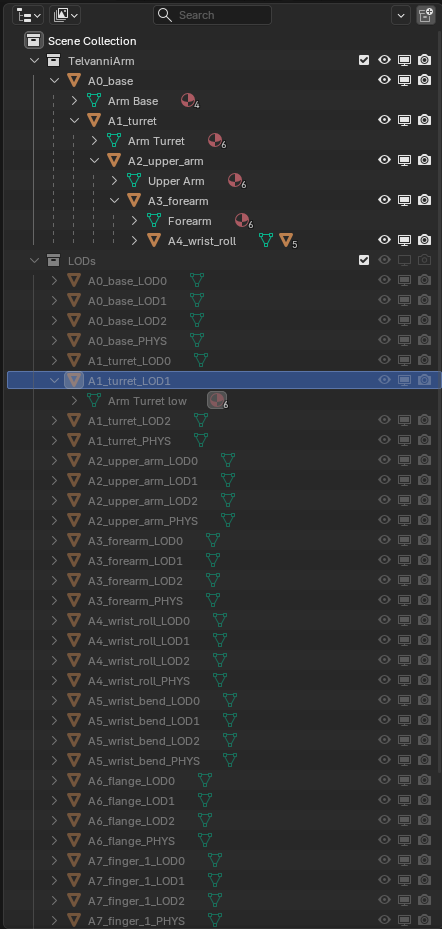
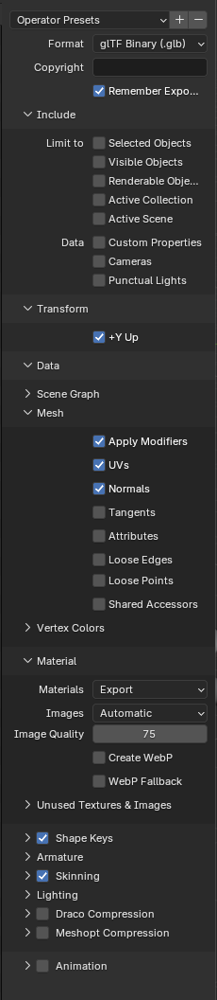

# Multi-Object Single-File Blender Exports

The example throughout is a robot arm built as a linkset of ten parts: a base, a turret, an upper arm, a forearm, two wrist joints, a flange and three fingers. Each part has its own levels of detail (LOD) and a physics shape, and the whole arm uploads from one file.

## How the uploader reads names

Second Life draws each part with up to four levels of detail (LOD): High up close, then Medium, Low and Lowest further away, plus a physics shape for collisions. The uploader matches each part to its LOD models and physics shape by name: the part's name plus a suffix that says which slot it fills.

| Slot in the uploader | Suffix | Example |
| --- | --- | --- |
| High (LOD3) | none | `A1_turret` |
| Medium (LOD2) | `_LOD2` | `A1_turret_LOD2` |
| Low (LOD1) | `_LOD1` | `A1_turret_LOD1` |
| Lowest (LOD0) | `_LOD0` | `A1_turret_LOD0` |
| Physics | `_PHYS` | `A1_turret_PHYS` |

Every part and all its LOD models go in one `.glb`. You pick that one file, and the uploader puts each LOD model and physics shape into its part's slot. Any LOD you leave out is generated from the part.

- Suffixes are upper case and go at the very end of the name.
- Don't use `_LOD` or `_PHYS` anywhere else in a name.
- No two parts may share a name.

## Setting up the file

Keep every part and its LOD models in one `.blend`, export the whole scene to one `.glb`, and pick that file in the uploader. Only the parts are uploaded; their `_LOD2`, `_LOD1`, `_LOD0` and `_PHYS` objects fill the parts' slots.

The arm's Blender file keeps them in two collections:

| Collection | Objects |
| --- | --- |
| `TelvanniArm` | the 10 parts: `A0_base`, `A1_turret` … `A7_finger_2` |
| `LODs` (hidden) | each part's LOD models and physics shape: `A1_turret_LOD2`, `A1_turret_LOD1`, `A1_turret_LOD0`, `A1_turret_PHYS`, and the same for every part |

### Object names, not mesh names

Each row in the Outliner is two things: the **object** (orange triangle, such as `A1_turret_LOD1`) and, under it, its **mesh data** (green triangle). The uploader reads only the object name. The mesh data is never read, so give it a plain label that can't be mistaken for one. The arm's are `Arm Turret`, `Arm Turret medium`, `Arm Turret low`, `Arm Turret lowest` and `Arm Turret collision`.

In the screenshot below, the parts are parented in a chain under `TelvanniArm`, each holding its mesh (`Arm Base`, `Arm Turret`, `Upper Arm` …). The hidden `LODs` collection holds every LOD object; `A1_turret_LOD1` holds the mesh `Arm Turret low`.

1. Name each part's object plainly (`A1_turret`), and each of its LOD objects with the suffix at the very end (`A1_turret_LOD1`). Delete Blender's `.001` endings.
2. Place each LOD model exactly over its part, with the same bounding box.
3. Export the whole scene with **Limit to** off, so the hidden LOD objects go in too.
4. Pick the `.glb` in **Build > Upload > Model**. The LOD dropdowns read **Load from file**, and the **Log** tab lists the LOD models taken from the file.

- **Each LOD needs every part.** If only some parts have a `_LOD1`, the Low LOD is generated for all of them, and the log says so.
- **Physics may be partial.** A part with no `_PHYS` gets the uploader's usual physics.
- **A suffixed object needs its part.** `A1_turret_LOD1` with no `A1_turret` in the file uploads as a part of its own.
- Each LOD model needs the same material slots as its part.

## glTF export settings

Use **File > Export > glTF 2.0** with these settings; anything not listed can stay at its default.

| Panel | Setting | Value |
| --- | --- | --- |
| Format | Format | glTF Binary (`.glb`) |
| Include > Limit to | all four | off, so the hidden LOD objects go in too |
| Include > Data | Cameras, Punctual Lights | off |
| Transform | +Y Up | on |
| Data > Mesh | Apply Modifiers | on |
| Data > Mesh | UVs, Normals | on |
| Data > Material | Materials | Export |
| Data > Compression | Draco Compression, Meshopt Compression | off |
| Animation | Animation | off |

Apply rotation and scale first (Ctrl+A), so the exported shape matches what you see.

## Common mistakes

Where each part turns in-world is set by its origin; that has [a guide of its own](object-origins.md).

| You see | Likely cause |
| --- | --- |
| `A1_turret_LOD2` uploads as a separate part | its part is missing or misspelt, or the name ends in `.001` |
| An LOD you made is generated anyway | not every part has that LOD |
| An LOD looks stretched in-world | its bounding box differs from its part's |
| An LOD is missing from the upload | Limit to was on when exporting, so the hidden LOD objects were left out |
