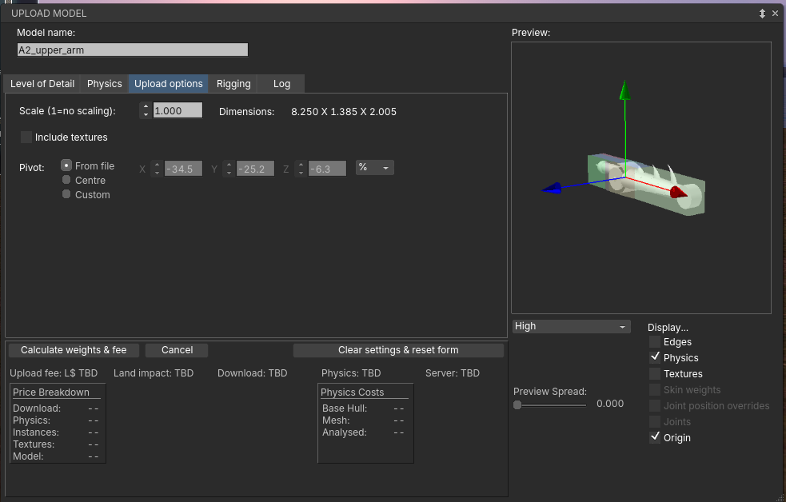

# Object Origins for Prim-Animated Doors, Hinges and Joints

## Why the origin matters

A prim in Second Life turns about its own position, and a mesh prim's position is the object origin it was uploaded with. Put the origin on the hinge, and a script that turns the door with `llSetLocalRot` swings it on its hinge. Leave it in the middle, and the door spins about its centre.

Until now the uploader always moved the origin to the middle of the object's bounding box. Doors were built with an invisible extra half, or a script had to move the prim as it turned it. The uploader's **Pivot** option keeps the origin you set in Blender instead.

## Setting the origin in Blender

1. Apply rotation and scale first: select the object, **Ctrl+A > Rotation & Scale**.
2. Put the 3D cursor on the hinge or joint: in Edit Mode select the vertices along the hinge line, then **Shift+S > Cursor to Selected**.
3. Back in Object Mode, **Object > Set Origin > Origin to 3D Cursor**.
4. Check it: rotate the object (R, then an axis key). It should turn about the hinge, and the orange dot should sit on it.

- **The origin must lie inside or on the object's bounding box.** The uploader stores it as a point within the box, so an origin outside is moved back to the centre.
- **Turn about a local axis.** Model the part so the hinge runs along X, Y or Z, so a script needs only one angle.
- Each part of a linkset has its own origin. An arm needs one per joint: the turret on its vertical axis, each limb on its elbow.

## The uploader's Pivot

The **Pivot** row is on the **Upload options** tab. It has three modes, X/Y/Z spinners beside them, and a status line under the spinners.

| Mode | The origin goes | Works for |
| --- | --- | --- |
| From file (default) | where Blender's origin was, for each object | one object or many |
| Centre | to the middle of the bounding box, as uploads always did | one object or many |
| Custom | where you type it in the spinners | a single object only |

- The spinners show the pivot along the object's own axes, in **percent** of its half size (−100 to 100, 0 = centre) or in **metres**; the dropdown beside them switches the unit.
- They are editable only in Custom, which starts from the pivot shown when you switch to it.
- Tick **Origin** under the preview to see the pivot: coloured arrows (X red, Y green, Z blue) drawn at each object's pivot.
- In a multi-object upload each part keeps its own origin, and its position in the linkset moves with it, so every part lands where it sat in Blender.

The status line says when the pivot is held at the centre, or when the collision stays centred:

| Status | Why | Fix |
| --- | --- | --- |
| Rigged mesh | rigged mesh is placed by its skeleton | none needed |
| Physics not analyzed | the sim fits a mesh physics shape to the box until it's analyzed | click **Analyze** on the Physics tab |
| No physics shape | the part moves to its pivot, but collides with a default hull centred on itself | fine for phantom parts or physics type None; otherwise add a physics shape and analyze it |

## Examples and common mistakes

| Part | Where the origin goes | Turns about |
| --- | --- | --- |
| Door | on the hinge edge, halfway up | its vertical axis |
| Chest lid | on the back edge, along the hinge | the hinge's axis |
| Arm turret | on the base's centre line | its vertical axis |
| Arm limb | in the joint at the limb's near end | the joint's axis |

A limb's joint is often at the very end of the part. That's fine: the origin may sit on the box's edge, just not outside it.

| You see | Likely cause |
| --- | --- |
| The part spins about its middle | the pivot is on Centre, the origin lies outside the box, or the physics isn't analyzed |
| The spinners read 0 0 0 on From file | Blender's origin was at the middle, or outside the box |
| The part rotates about the wrong axis | rotation wasn't applied before export |
| Custom is greyed out | the upload has several objects; Custom is for a single one |
